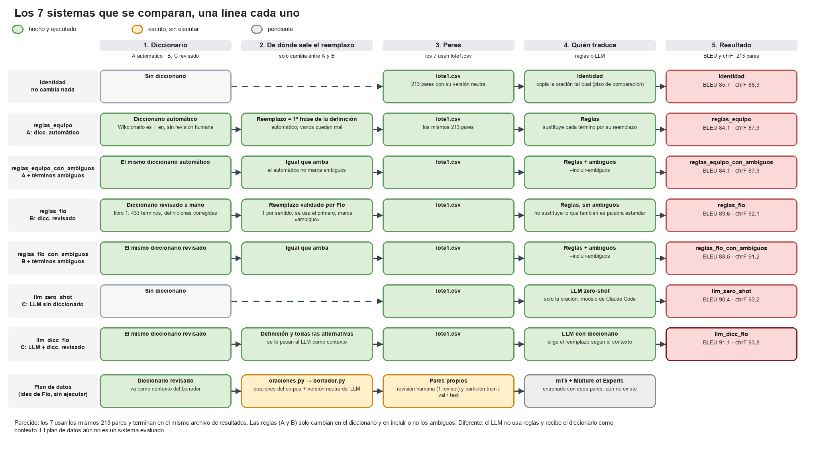
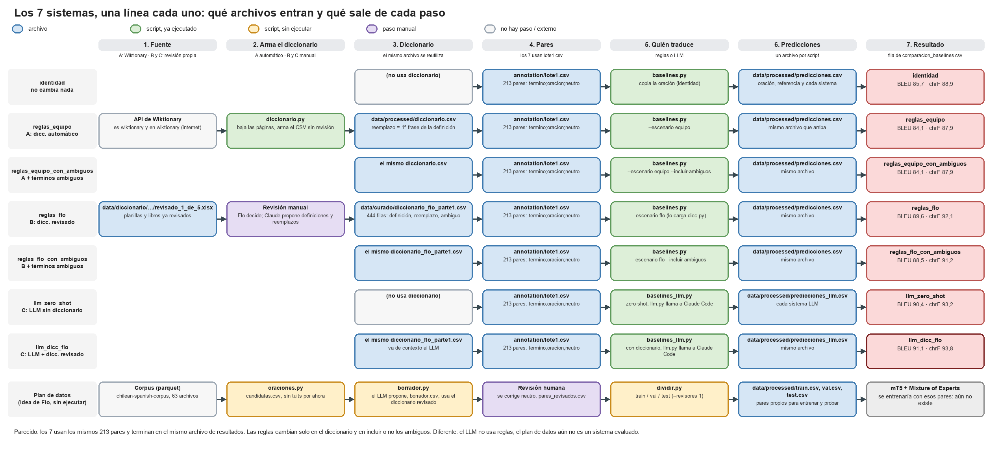
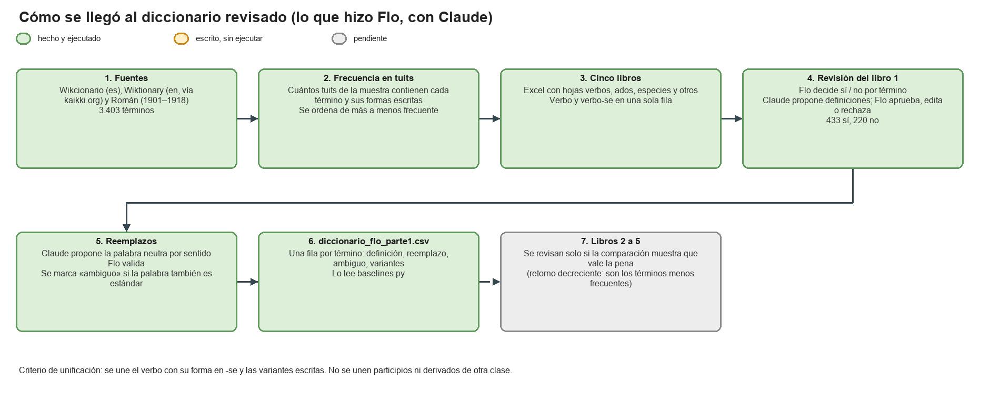

# Proyecto NLP: Chilenismos

## Objetivo

Traducir oraciones con jerga chilena (*«el carrete estuvo fome»*) a español neutro (*«la fiesta estuvo aburrida»*), y medir qué enfoque lo hace mejor.
Proyecto del curso de PLN (UC Chile).

Este README explica los **tres sistemas** que hay en el repo y cómo se comparan. Cada uno tiene su propio detalle:

| Documento | De qué trata |
|---|---|
| **este README** | Visión general: los tres sistemas, qué tienen de parecido y de diferente, resultados y qué falta |
| [`README_flo.md`](README_flo.md) | Sistema B: el diccionario revisado a mano, sus columnas y cómo se integra con el código del equipo |
| [`idea_flo/README.md`](idea_flo/README.md) | Sistema C: el plan de datos original (oraciones, borrador con LLM, revisión humana, partición) y los baselines con LLM |

## Los tres sistemas

Los tres se evalúan con los **mismos pares** (`annotation/lote1.csv`) para poder compararlos. Cada uno de los tres se corre en una o más variantes, así que en total se comparan **7 sistemas** (las filas de `resultados/comparacion_baselines.csv`): identidad; `reglas_equipo` y `reglas_equipo_con_ambiguos` (A); `reglas_flo` y `reglas_flo_con_ambiguos` (B); `llm_zero_shot` y `llm_dicc_flo` (C). Los diagramas muestran las 7 líneas, cada una con su resultado.



| Sistema | Qué hace | Estado |
|---|---|---|
| **A. Reglas + diccionario automático (equipo)** | `diccionario.py` baja el Wikcionario (es y en) y arma un diccionario sin revisión; el reemplazo de cada término es la primera frase de su definición. `baselines.py` sustituye con esas reglas (y corre identidad y mT5 sin entrenar). | Hecho y ejecutado. |
| **B. Reglas + diccionario revisado (Flo)** | El mismo código que A, pero con un diccionario revisado a mano: se decidió qué términos entran, se corrigieron las definiciones y se validó un reemplazo por sentido. Detalle en [`README_flo.md`](README_flo.md). | Hecho y ejecutado, **pero solo para el libro 1 de 5** (ver «Pendiente de revisar»). |
| **C. LLM + diccionario revisado (idea de Flo)** | No usa reglas: le entrega al LLM la oración y los términos del diccionario revisado que aparecen en ella. Además arma sus propios pares (oraciones del corpus → borrador con LLM → revisión humana → train / val / test). Detalle en [`idea_flo/README.md`](idea_flo/README.md). | Baselines con LLM hechos y ejecutados. La generación de pares está escrita pero **sin ejecutar ni revisar**. |

### Qué tienen de parecido y de diferente
- **A y B** usan el mismo script (`baselines.py`) y los mismos pares. **Solo cambia el diccionario**: automático en A, revisado a mano en B.
- **B y C** comparten el mismo diccionario revisado.
- **C** es la única que no usa reglas fijas (el LLM decide según el contexto) y la única que arma sus propios pares.
- **Los tres** terminan en el mismo archivo de resultados.

### Qué archivos entran y salen de cada paso



### Cómo se llegó al diccionario revisado (sistema B)



Los diagramas se pueden editar con [draw.io](https://app.diagrams.net) abriendo `docs/pipelines.drawio` (tiene las tres páginas).

## Organización del repo

```
proyecto-nlp/
├── README.md                 este documento: visión general de los tres sistemas
├── README_flo.md             sistema B: el diccionario revisado
├── requirements.txt
├── src/chilenismos/          código del equipo (sistemas A y B)
│   ├── diccionario.py        baja Wikcionario es + en y arma data/processed/diccionario.csv
│   ├── baselines.py          identidad, reglas y mT5; elige el diccionario con ESCENARIO
│   └── dicc.py               carga un diccionario (equipo o Flo) y arma las reglas
├── idea_flo/                 sistema C: LLM + plan de datos (ver idea_flo/README.md)
│   ├── llm.py, baselines_llm.py
│   └── oraciones.py, borrador.py, dividir.py
├── annotation/
│   └── lote1.csv             los 213 pares con que se comparan los tres sistemas
├── data/
│   ├── curado/               diccionario revisado: diccionario_flo_parte1.csv y términos descartados
│   ├── diccionario/          el trabajo previo de Flo (ver abajo)
│   ├── raw/, interim/, processed/   salidas de los scripts; no se suben a git
├── resultados/
│   └── comparacion_baselines.csv    BLEU y chrF de cada sistema
├── docs/                     diagramas (pipelines.drawio y sus PNG)
└── configs/, models/, notebooks/, reports/, tests/    vacías por ahora (.gitkeep)
```

`data/diccionario/` guarda el trabajo previo de revisión:

```
data/diccionario/
├── crudo/                    descargas en bruto: Wikcionario (es), kaikki.org (en) y Román
├── procesado/                términos unidos, acepciones, planillas variantes_parte*.xlsx
│   ├── revision/             los 5 libros por frecuencia y lo ya revisado del libro 1
│   ├── informes/             registros de lo aplicado
│   └── reemplazadas/         copias de seguridad
└── reglas_medicion/          medición de las reglas de ortografía (solo el resumen por regla se sube)
```

**No se suben a git** (ver `.gitignore`): los Excel de `data/diccionario/` (traen ejemplos tomados de tuits), todo `crudo/` (descargas en bruto y texto de artículos con derechos de autor), `informes/`, los intermedios `es_acepciones.jsonl` y `terminos.jsonl` (este último es un duplicado de `terminos.csv`) y las listas de formas de `reglas_medicion/`. Siguen en tu carpeta local. Ningún sistema de este repo lee `data/diccionario/`: es el respaldo del trabajo previo de revisión.

## Resultados hasta ahora

BLEU y chrF sobre los 213 pares de `lote1.csv` (`resultados/comparacion_baselines.csv`):

| Sistema | BLEU | chrF |
|---|---|---|
| Identidad (no cambia nada) | 85,7 | 88,9 |
| **A.** Reglas con el diccionario automático | 84,1 | 87,9 |
| **B.** Reglas con el diccionario revisado | 89,6 | 92,1 |
| **B.** Reglas con el diccionario revisado, incluyendo ambiguos | 88,5 | 91,2 |
| **C.** LLM zero-shot | 90,4 | 93,2 |
| **C.** LLM con el diccionario revisado como contexto | **91,1** | **93,8** |

Cómo leerlo:
- **Preliminar.** `lote1.csv` se armó con términos del diccionario del equipo y las referencias cambian poco del original, así que la identidad ya parte alta. Hay que repetirlo con un conjunto de prueba independiente.
- **Los reemplazos del diccionario automático** salen de la primera frase de la definición y varios quedan mal (*buena onda* → «expresión de saludo»). Con el diccionario revisado, 76 de 117 sustituciones coinciden con la referencia; con el automático, 12 de 95.
- **Los términos ambiguos** (*andar*, *pesado*, *once*) no se sustituyen por defecto: hacerlo empeora el resultado.
- **LLM:** las filas `llm_*` usan el modelo de Claude Code (backend `claude-code`), anotado en la columna `nota`. Si las referencias de `lote1.csv` también las redactó un LLM, esto puede favorecerlo. Conviene comprobar cómo se generaron.

## Pendiente de revisar

Esto es trabajo de revisión humana que **todavía no se hace**:

- **Libros 2 a 5 del diccionario.** Solo el libro 1 (las ~650 filas más frecuentes) está revisado. Las ~2.600 filas restantes están en `data/diccionario/procesado/revision/revision_2_de_5.xlsx` … `revision_5_de_5.xlsx` y siguen sin decisión (sí / no), sin definiciones corregidas y sin reemplazos. Mientras tanto, **los sistemas B y C solo conocen los términos del libro 1**. La idea es revisarlos solo si los resultados muestran que vale la pena (retorno decreciente: son los menos frecuentes).
- **Pares de entrenamiento y prueba.** Nadie ha revisado todavía el borrador de ningún par: `oraciones.py` y `borrador.py` no se han ejecutado. Se decidió empezar con **un solo revisor** (sin medir acuerdo entre personas) y declararlo como limitación.
- **Reemplazos de los términos de los libros 2 a 5** y revisión de sus definiciones, que dependen del punto anterior.

## Qué más falta
- Generar los pares (ver [`idea_flo/README.md`](idea_flo/README.md)). Antes de publicar texto de tuits hay que consultar al profesor.
- Entrenar mT5 y la variante con Mixture of Experts (la idea del *graphical abstract*); hoy solo existe mT5 sin entrenar.
- Baseline de Google Translate, BERTScore y evaluación humana.

## Cómo correr

```
pip install -r requirements.txt
python src/chilenismos/diccionario.py                                   # crea data/processed/diccionario.csv (sistema A)
python src/chilenismos/baselines.py --escenario ambos --sin-mt5 --resumen resultados/comparacion_baselines.csv
python idea_flo/baselines_llm.py --resumen resultados/comparacion_baselines.csv   # sistema C (ver idea_flo/README.md)
```

La variable `ESCENARIO` de `baselines.py` (o `--escenario equipo|flo|ambos`) elige con qué diccionario se corren las reglas.

## Licencias y datos
Wikcionario y Wiktionary son CC BY-SA, así que el diccionario derivado se publica con la misma licencia. Román (1901–1918) es dominio público.
El *Chilean Spanish Corpus* es CC-BY-SA-4.0 y no se redistribuye. No se suben tuits al repo: los Excel de `data/diccionario/` traen ejemplos de tuits y por eso están en `.gitignore`. Las claves de API van siempre en variables de entorno.
