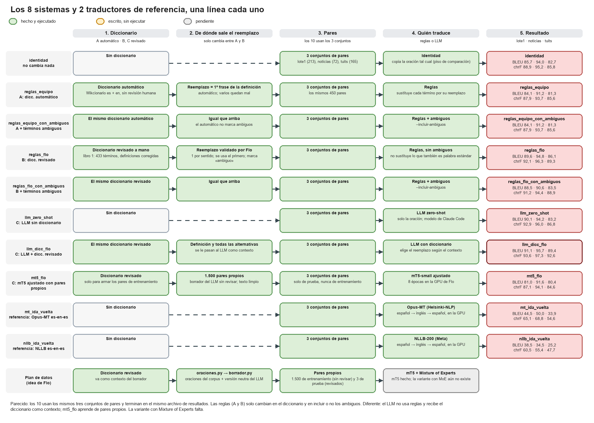
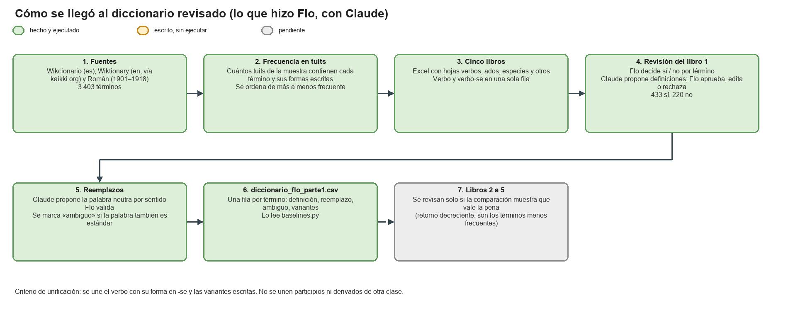
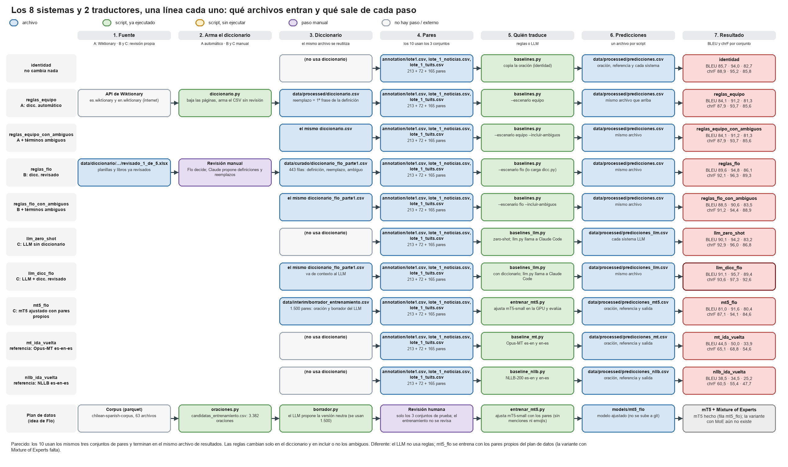

# Rama `flo`: diccionario revisado e integración al código del equipo

Trabajo de Flo, con ayuda de Claude (asistente de IA) para proponer definiciones, reemplazos y código.
Lo que propuso Claude lo validó Flo.

Este documento describe el **sistema B** (reglas + diccionario revisado a mano). Visión general de los tres sistemas: [`README.md`](README.md). El sistema C (LLM + plan de datos): [`idea_flo/README.md`](idea_flo/README.md).



## Qué se hizo

### 1. Diccionario base y revisión (`data/diccionario/`)
El trabajo previo (con esta estructura; **no se subió al repo, lo tiene solo Flo**; en `data/diccionario/` solo están `terminos.csv`, las acepciones y `roman_entradas.jsonl`) trae: descargas (`crudo/`), planillas y libros de revisión (`procesado/`, `procesado/revision/`) y la medición de reglas ortográficas (`reglas_medicion/`). **Los Excel no se suben a git** porque traen ejemplos tomados de tuits (ver `.gitignore`).

- **Fuentes:** Wikcionario en español (categoría ES:Chile), Wiktionary en inglés (vía kaikki.org) y el diccionario de Román (1901–1918). 3.403 términos.
- **Frecuencia:** cada término se buscó en una muestra de tuits del *Chilean Spanish Corpus* y se ordenó de más a menos frecuente. Se dividió en 5 libros; **solo el libro 1 (los más frecuentes) está revisado**.
- **Revisión término por término** (Flo): ¿entra? ¿tiene un sentido chileno distinguible? ¿la definición es correcta? Las definiciones que fallaban (glosas en inglés, sentidos mezclados, vacías) las propuso Claude con tuits de ejemplo, y Flo aprobó, editó o rechazó cada una.
- **Criterio de unificación:** se une el verbo con su forma en -se y las variantes escritas. No se unen participios o adjetivos derivados ni derivados de otra clase gramatical.
- **Resultado del libro 1:** 433 términos aceptados y 220 descartados (nombres propios, palabras estándar sin sentido chileno, ruido).



### 2. Qué hay en la rama



| Archivo | Qué es |
|---|---|
| `data/diccionario/` | Del trabajo previo de Flo, solo lo que se sube (`terminos.csv`, acepciones, Román). Planillas, libros y descargas no se subieron: los tiene solo Flo. |
| `data/curado/diccionario_flo_parte1.csv` | Diccionario revisado, una fila por término (443 filas: los pares verbo / verbo-se se separan). |
| `data/curado/terminos_descartados_parte1.csv` | Los 220 descartados, con su nota. |
| `src/chilenismos/dicc.py` | Carga un diccionario (del equipo o de Flo) y arma las reglas de reemplazo. |
| `src/chilenismos/baselines.py` | Archivo del equipo, con la variable `ESCENARIO`, lectura del formato de `lote1.csv` y `--resumen`. |
| `resultados/comparacion_baselines.csv` | BLEU y chrF de cada sistema (ver más abajo). |
| `idea_flo/` | El plan de datos original de Flo, aparte del código del equipo (ver `idea_flo/README.md`). |

### 3. Columnas de `diccionario_flo_parte1.csv`
`termino`, `grupo` (si venía unido con su forma en -se), `tipo` (verbo / adjetivo_participio / especie / otro), `definicion`, **`reemplazo`**, **`ambiguo`**, **`reemplazo_validado`**, `keep` (siempre 1), `variantes` (formas escritas alternativas, solo para no-verbos), `n_tuits_muestra`, `notas`.

- **`reemplazo`:** la palabra o frase neutra que sustituye al término, para el sentido más frecuente. Vacío si no hay equivalente estable (especies, platos típicos, siglas, interjecciones).
- **Varios sentidos:** admite alternativas separadas por `|` (por ejemplo `arruinar | engañar` en *cagar*). El baseline de reglas usa solo la primera; un LLM con el diccionario como contexto las recibe todas.
- **`ambiguo = 1`:** la palabra también se usa mucho con su sentido estándar (*andar*, *pesado*, *mina*, *once*). El baseline de reglas **no la sustituye** salvo que se pida `--incluir-ambiguos`.
- **`reemplazo_validado`:** 1 si Flo validó el reemplazo (hoy son todos).

## Cómo elegir con qué diccionario se corre

En `src/chilenismos/baselines.py` hay una variable:

```python
ESCENARIO = "equipo"   # "equipo" | "flo" | "ambos"
```

- `equipo`: el diccionario automático de `diccionario.py` (`data/processed/diccionario.csv`).
- `flo`: el diccionario revisado (`data/curado/diccionario_flo_parte1.csv`).
- `ambos`: corre los dos con los mismos pares y los compara en la misma tabla.

También por línea de comandos:

```
python src/chilenismos/baselines.py --escenario ambos --sin-mt5 --resumen resultados/comparacion_baselines.csv
python src/chilenismos/baselines.py --escenario flo --incluir-ambiguos --sin-mt5
```

`--pares` acepta el formato de `annotation/lote1.csv` (`termino;oracion;neutro`) y el de `chileno,neutro`.

## Resultados

BLEU / chrF en los tres conjuntos de pares, medidos sobre texto sin `@usuario` ni emojis (`resultados/comparacion_baselines.csv`; tabla completa con los 8 sistemas en el [README global](README.md)), con el sistema A como punto de comparación:

| Sistema | lote1.csv (213) | lote_1_noticias (72) | lote_1_tuits (165) |
|---|---|---|---|
| Identidad (no cambia nada) | 85,7 / 88,9 | 94,0 / 95,2 | 82,7 / 85,8 |
| A. Reglas con el diccionario automático | 84,1 / 87,9 | 91,2 / 93,7 | 81,3 / 85,6 |
| **B.** Reglas con el diccionario revisado | **89,6 / 92,1** | **94,8 / 96,3** | **86,1 / 89,3** |
| **B.** … incluyendo ambiguos | 88,5 / 91,2 | 90,6 / 94,4 | 83,5 / 88,9 |

- Con el diccionario revisado, 76 de 117 sustituciones coinciden con la referencia; con el automático, 12 de 95.
- Sustituir también los términos marcados `ambiguo` baja 1,1 BLEU: por eso no se sustituyen por defecto.
- **Posible favoritismo:** Flo revisó las referencias de los dos lotes de Flo y, con ese mismo diccionario, validó los reemplazos, así que B podría salir algo favorecido en esos dos conjuntos. Se corregirá con otro revisor en el futuro. `lote1.csv` no lo escribió Flo y ahí también gana B.
- **Faltan palabras por revisar:** el diccionario se separó en 5 partes por frecuencia en los tuits y solo se revisó la primera (la más frecuente); faltan las otras cuatro.
- `lote1.csv` se armó con términos del diccionario del equipo y las referencias cambian poco del original, así que la identidad ya parte alta. Los resultados del sistema C (LLM) están en [`idea_flo/README.md`](idea_flo/README.md).

## Pendiente de revisar

**Flo todavía no revisa los libros 2 a 5.** Hoy el diccionario revisado cubre solo el libro 1 (las ~650 filas más frecuentes de 3.403 términos). Eso significa:

- Las ~2.600 filas restantes están en `archivos_fuera_del_repo/data/diccionario/procesado/revision/revision_2_de_5.xlsx` … `revision_5_de_5.xlsx` **sin decisión** (sí / no), sin definiciones corregidas y sin reemplazos.
- `diccionario_flo_parte1.csv` **no incluye ninguno de esos términos**: los sistemas B y C no los conocen.
- Todavía hay que decidir si vale la pena revisarlos; son los menos frecuentes (retorno decreciente). La comparación de `resultados/comparacion_baselines.csv` ayuda a decidirlo.
- Lo que falta revisar por cada libro es lo mismo que se hizo con el libro 1: ¿el término entra?, ¿la definición es correcta?, y luego el reemplazo por sentido.

También sigue pendiente aplicar las decisiones del libro 1 a las planillas `archivos_fuera_del_repo/data/diccionario/procesado/variantes_parte*.xlsx` (pintar de gris los «no» y copiar las definiciones finales). Por ahora esas decisiones viven solo en `revisado_1_de_5.xlsx` y en `data/curado/`.

## Limitaciones conocidas
- **Una regla fija no desambigua.** *Pega* es «trabajo» o «inconveniente» según la oración; la regla usa solo el primer reemplazo.
- **No conjuga.** El reemplazo de un verbo se aplica solo al infinitivo; *carreteamos* no se arregla. Tampoco ajusta género y número.
- **Ruido de formas.** Las variantes generadas por reglas ortográficas pueden coincidir con palabras estándar. No se revisaron una por una a propósito.
- **Los pares de `lote1.csv` se armaron con términos del diccionario del equipo** y las referencias cambian poco del original, así que la identidad ya parte alta. Los números sirven de comparación preliminar.

## Licencias
Wikcionario y Wiktionary son CC BY-SA, así que el diccionario derivado se publica con la misma licencia. Román es dominio público. El corpus es CC-BY-SA-4.0 y no se redistribuye.
