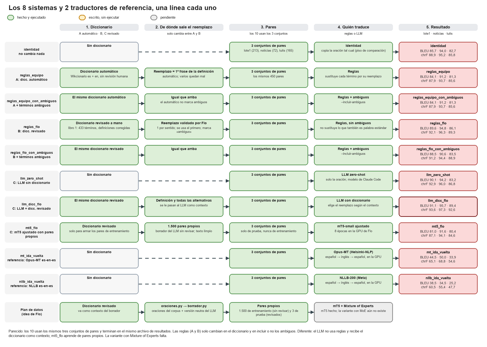

# Baselines (comparación preliminar)

Esta página no es parte del flujo de generación del dataset. Sirve como punto de comparación para el modelo que se entrenará después.
Todos los baselines se evalúan con los 213 pares de `annotation/lote1.csv`, y los resultados se acumulan en `reports/comparacion_baselines.csv`.

| Sistema | Script | BLEU | chrF |
|---|---|---|---|
| Identidad (no cambia nada) | `baselines.py` | 85,7 | 88,9 |
| Reglas con el diccionario automático (`equipo`) | `baselines.py` | 84,1 | 87,9 |
| Reglas con el diccionario curado (`flo`) | `baselines.py` | 89,6 | 92,1 |
| Reglas con el diccionario curado, incluyendo ambiguos | `baselines.py --incluir-ambiguos` | 88,5 | 91,2 |
| LLM zero-shot | `baselines_llm.py` | 90,4 | 93,2 |
| LLM con el diccionario curado como contexto | `baselines_llm.py` | **91,1** | **93,8** |

```
python src/chilenismos/baselines.py --escenario ambos --sin-mt5 --resumen
python src/chilenismos/baselines_llm.py --seco        # muestra el prompt sin llamar al LLM
python src/chilenismos/baselines_llm.py --resumen
```

`--resumen` sin valor escribe en `reports/comparacion_baselines.csv`. `baselines.py` también puede correr mT5 **sin entrenar**; para saltarlo, se usa `--sin-mt5`.

## Cómo leerlo

- **Son resultados preliminares.** `lote1.csv` se armó con términos del diccionario automático, y sus referencias cambian poco respecto del original, así que la identidad ya parte alta. Hay que repetir la comparación con el `test.csv` que sale del flujo.
- Con el diccionario curado, 76 de 117 sustituciones coinciden con la referencia. Con el automático coinciden 12 de 95, porque su reemplazo sale de la primera frase de la definición.
- Sustituir también los términos ambiguos empeora el resultado.
- Si las referencias de `lote1.csv` las redactó un LLM, los sistemas con LLM salen favorecidos. Falta comprobar cómo se generaron.

## Backends del LLM (`llm.py`)

- **`claude-code` (por defecto):** llama al CLI de Claude Code con la sesión ya iniciada. No usa clave de API. Así se hicieron todas las corridas.
- **`anthropic`:** necesita `ANTHROPIC_API_KEY` en el entorno y cobra por uso. Nunca se probó. El paquete `anthropic` es opcional.

## Diagramas de la versión anterior

`pipelines.drawio` y `pipelines_{1,2,3}.png` muestran los tres sistemas tal como estaban antes de unificar el repo. Las rutas que aparecen ahí (`idea_flo/`, `resultados/`) ya no existen: hoy todo está en `src/chilenismos/` y `reports/`.


