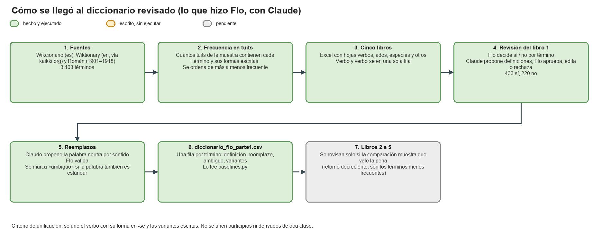

# Diccionario curado (`data/curado/`)

Trabajo de Flo, con ayuda de Claude (asistente de IA) para proponer definiciones, reemplazos y código. Flo validó todo lo que propuso Claude.
Es el diccionario que usa por defecto el flujo de generación del dataset (`--escenario flo`, ver [`../README.md`](../README.md)).

## Cómo se armó

- **Fuentes:** Wikcionario en español (categoría ES:Chile), Wiktionary en inglés (vía kaikki.org) y el diccionario de Román (1901–1918). En total son 3.403 términos, guardados en `data/diccionario/procesado/terminos.csv`.
- **Frecuencia:** cada término se buscó en una muestra de tuits del *Chilean Spanish Corpus* y la lista se ordenó de más a menos frecuente. Luego se dividió en 5 libros. **Solo el libro 1 (el de los términos más frecuentes) está revisado.**
- **Revisión término por término:** para cada uno se preguntó si entra, si tiene un sentido chileno distinguible y si la definición es correcta. Claude propuso con tuits de ejemplo las definiciones que fallaban, y Flo aprobó, editó o rechazó cada una.
- **Unificación:** se une el verbo con su forma en -se y las variantes escritas. No se unen participios ni derivados de otra clase gramatical.
- **Resultado del libro 1:** 433 términos aceptados (444 filas, porque los pares verbo / verbo-se van en filas separadas) y 220 descartados (`terminos_descartados_parte1.csv`).

## Columnas de `diccionario_flo_parte1.csv`

Las columnas son `termino`, `grupo`, `tipo` (verbo / adjetivo_participio / especie / otro), `definicion`, `reemplazo`, `ambiguo`, `reemplazo_validado`, `keep` (siempre 1), `variantes`, `n_tuits_muestra` y `notas`.

- **`reemplazo`:** el equivalente neutro del sentido más frecuente. Queda vacío cuando no hay equivalente estable (especies, platos típicos, siglas). Puede traer alternativas separadas por `|` (por ejemplo, `arruinar | engañar`). Las reglas usan solo la primera alternativa, y el LLM recibe todas.
- **`ambiguo = 1`:** marca palabras que también se usan mucho con su sentido estándar (*andar*, *pesado*, *once*). Las reglas no las sustituyen, salvo que se pase `--incluir-ambiguos`.
- **`variantes`:** formas escritas alternativas (solo para los que no son verbos).

## `data/diccionario/` (respaldo)

Guarda el trabajo previo de revisión: las fuentes procesadas, las acepciones y la medición de reglas ortográficas. Ningún script lo lee. **Los Excel y las descargas en bruto no se suben a git** porque traen tuits o texto con derechos de autor (ver `.gitignore`).

## Pendiente

- **Libros 2 a 5 sin revisar.** Son unas 2.600 filas, en `data/diccionario/procesado/revision/revision_{2..5}_de_5.xlsx` (solo locales). Todavía no tienen decisión, definición corregida ni reemplazo. Mientras eso no cambie, el flujo solo conoce los términos del libro 1. Revisarlos vale la pena solo si los resultados lo justifican, porque son los términos menos frecuentes.
- Falta aplicar las decisiones del libro 1 a las planillas `variantes_parte*.xlsx`.

## Limitaciones de las reglas

- Una regla fija no desambigua: *pega* puede ser «trabajo» o «inconveniente», y la regla siempre usa el primer reemplazo.
- Las reglas no conjugan ni ajustan género y número: *carreteamos* queda sin reemplazo.
- Las variantes ortográficas pueden coincidir con palabras estándar.
