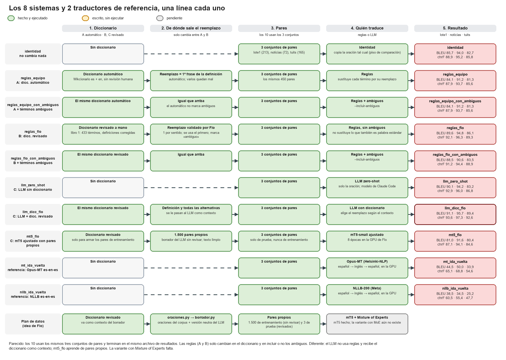
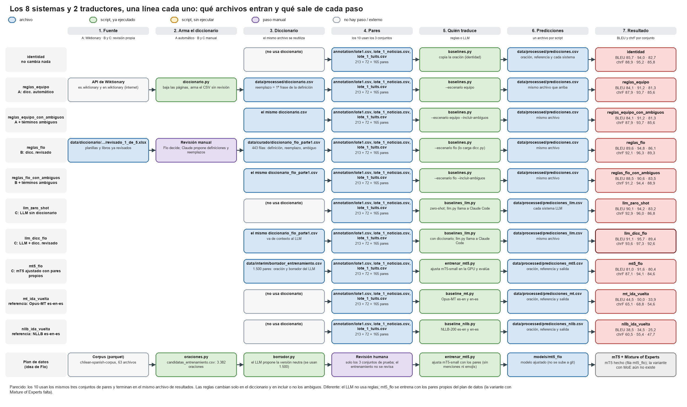
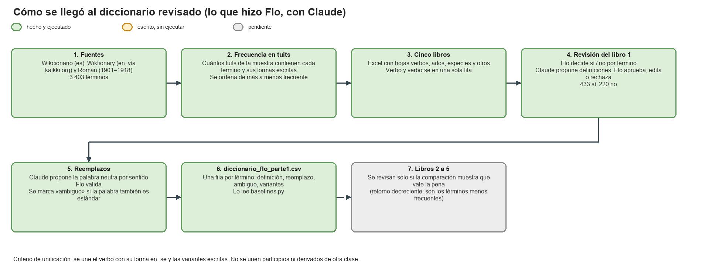

# Informe interno del proyecto: traductor de chilenismos

**Para qué sirve este documento.** Es un resumen para todo el grupo. Explica qué queremos hacer, qué se ha hecho (por Nicolás y por Florencia), qué resultados hay y qué falta. **No es el documento de la entrega**: sigue la estructura que piden (graphical abstract, recolección de datos, diseño experimental, resultados experimentales y próximos pasos) para que de aquí se pueda armar la entrega.

Los números salen de `resultados/comparacion_baselines.csv`. Cada carpeta tiene su propio README con más detalle (`README.md`, `README_flo.md`, `idea_flo/README.md`, `annotation/README.md`, `data/README.md`).

---

## 0. En una página

- **Objetivo:** un sistema que reciba una oración con jerga chilena (*«el carrete estuvo fome»*) y devuelva la misma oración en español neutro (*«la fiesta estuvo aburrida»*), cambiando solo la jerga.
- **Cómo medimos:** comparamos la salida de cada sistema con una versión neutra escrita por una persona, usando **BLEU** y **chrF** (cuánto se parece el texto). Cuanto más alto, mejor.
- **Se comparan 8 sistemas** en **3 conjuntos de pares** (oración chilena + versión neutra de referencia). Los sistemas están agrupados en tres familias:
  - **A.** Reglas + diccionario automático (lo de Nicolás).
  - **B.** Reglas + diccionario revisado a mano (lo de Flo).
  - **C.** LLM (un modelo de lenguaje tipo Claude) + diccionario revisado (idea de Flo).
- **Resultado principal:** el mejor sistema en los tres conjuntos es el **LLM con el diccionario revisado** (`llm_dicc_flo`). Las **reglas de Nicolás con el diccionario automático empeoran** el texto respecto de no hacer nada. El diccionario revisado a mano es lo que marca la diferencia.
- **Lo que falta:** revisar los otros 4 libros del diccionario, que un **segundo revisor** revise los pares de Flo, entrenar un modelo propio (mT5 y su variante con Mixture of Experts), y la evaluación humana.

Los diagramas con los 8 sistemas están en la sección 1.

---

## 1. Graphical abstract

La idea completa del proyecto, de punta a punta:

1. **Diccionario de chilenismos** (qué palabras y qué significan).
2. **Oraciones reales** del corpus que contienen esas palabras.
3. **Pares** *oración chilena → oración neutra* (primero un borrador que propone un LLM; después una persona lo corrige).
4. **Sistemas que traducen**: reglas de sustitución, LLM, y un modelo propio (mT5, con una variante de *Mixture of Experts*).
5. **Evaluación**: BLEU y chrF contra las versiones revisadas (y, más adelante, evaluación humana).

**Diagrama 1: los 8 sistemas.** Cada sistema va en una línea, con su diccionario, los pares, quién traduce y su resultado en los tres conjuntos (BLEU y chrF):



**Diagrama 2: qué archivos entran y salen de cada paso.**



**Diagrama 3: cómo se hizo el diccionario revisado.**



Los diagramas se editan con [draw.io](https://app.diagrams.net) abriendo `docs/pipelines.drawio`.

---

## 2. Recolección de datos

### 2.1 Qué hizo Nicolás

El equipo dejó armada la base del repo (carpeta `src/chilenismos/`):

- **`diccionario.py`:** baja de internet las palabras que el Wikcionario marca como chilenas, en español (`es.wiktionary.org`, categoría *ES:Chile*) y en inglés (`en.wiktionary.org`, *Chilean Spanish*). Une las dos fuentes y escribe `data/processed/diccionario.csv` (unas 3.600 filas). **No lo revisa nadie**, y el «reemplazo» de cada término es simplemente **la primera frase de su definición**. Por eso varios reemplazos quedan mal (*buena onda → «expresión de saludo»*).
- **`baselines.py`:** corre tres sistemas simples: **identidad** (copia la oración sin cambiarla, es el piso de comparación), **reglas** (sustituye cada término del diccionario por su reemplazo) y **mT5 sin entrenar** (todavía no aprendió nada).
- **`annotation/lote1.csv`:** el primer conjunto de pares de Nicolás: **213 pares de 96 términos**. No sabemos de qué fuente salen las oraciones ni cómo se escribieron las versiones neutras (probablemente con un modelo). Hay que preguntárselo a Nicolás (ver sección 5).

### 2.2 Qué hizo Flo

**a) Un diccionario revisado a mano.** Partiendo de tres fuentes (Wikcionario en español, Wiktionary en inglés vía kaikki.org, y el diccionario de Román de 1901–1918) se juntaron **3.403 términos**. Se contó cuántas veces aparece cada uno en una muestra de tuits y se ordenaron de más a menos frecuente, y se dividieron en **5 libros** (planillas Excel). Para cada término del **libro 1** (los ~650 más frecuentes):

- Flo decidió **sí / no** (se usa o no se usa; nombres propios, palabras estándar y ruido quedan afuera): **433 sí y 220 no**.
- Se corrigieron las definiciones (Claude propuso, Flo aprobó, editó o rechazó) y se unificaron variantes (el verbo con su forma en *-se*, variantes de escritura).
- Se propuso y se **validó un reemplazo por cada sentido** (por ejemplo, *cagar* → «arruinar» y «engañar»), y se marcó como **ambiguo** el término que también es una palabra estándar muy común (*andar*, *pesado*, *once*): esos no se sustituyen salvo que se pida.

El resultado es **`data/curado/diccionario_flo_parte1.csv`** (443 filas, 328 con reemplazo). Es lo que leen los sistemas B y C. Las notas que Flo dejó al revisar los lotes ya se aplicaron al diccionario: *asado* → «parrillada»; *cortar* solo con el sentido de terminar una relación; *fonda* ahora es «feria costumbrista»; *no más* se quitó; *andar* queda con una nota de duda y *pelar el chancho* se anotó como dicho. El trabajo previo (planillas, libros de revisión y descargas) **no se subió al repositorio: lo tiene solo Flo**. De todo eso se subió únicamente `terminos.csv` (los 3.403 términos), las acepciones y `roman_entradas.jsonl`, en `data/diccionario/`.

**b) El corpus.** Usamos el *Chilean Spanish Corpus* (`jorgeortizfuentes/chilean-spanish-corpus`, licencia CC-BY-SA-4.0): 63 archivos, con mc4 (8,7 M de textos), tuits (27,3 M), noticias (1,08 M) y reclamos (31 mil). No se redistribuye ni se sube al repo.

**c) Dos lotes de pares propios.** Para no depender solo de `lote1.csv`, se construyeron dos conjuntos con las **100 palabras más frecuentes** del diccionario revisado (sin nombres de especies), 2 oraciones por palabra, escogidas al azar entre 25 y 240 caracteres (sin retuits ni links; las menciones de usuarios se cambian por `@usuario`):

| Lote | Fuente | Pares | Usados | Descartados |
|---|---|---|---|---|
| `lote_1_noticias.csv` | noticias | 93 | 72 | 21 |
| `lote_1_tuits.csv` | tuits | 194 | 165 | 29 |

Cada par se hizo así: un LLM propuso la versión neutra («borrador»), y **Flo la revisó** en un Excel (`ok`, `corregir` o `descartar`). Un par se descarta si la palabra está en su sentido estándar (por ejemplo *Colonia* la ciudad), si es un nombre propio o si el texto no sirve. **Solo se evalúa con pares revisados.**

Dos precauciones: `lote_1_tuits.csv` **sí se sube al repo** (decisión de Flo; el texto se revisó y no tiene nombres ni datos personales, las menciones van como `@usuario`; el repo de GitHub es público, tenerlo presente); los Excel de revisión y los libros del diccionario (traen ejemplos de tuits sin filtrar) Flo los guarda fuera del repo, en `PLN/Proyecto/archivos_fuera_del_repo/`), y las claves de API nunca se guardan en el repo.

### 2.3 Datos de entrenamiento para el modelo propio

Para entrenar mT5 hacen falta muchos más pares. Se buscaron **3.382 oraciones** (sobre todo de tuits) para los términos del libro 1, y el LLM escribió la versión neutra de **1.500** de ellas, elegidas al azar (se usó solo una parte para gastar menos del plan; el script guarda cada 100 y puede retomarse). Después de quitar duplicados y las oraciones de los conjuntos de prueba quedan **1.491 pares: 1.416 para entrenar y 75 para validar**. Estos pares **no los revisa una persona** (son «datos plata»), y se les quitan las oraciones que están en los conjuntos de prueba. Se usan solo para entrenar; la prueba usa únicamente pares revisados.

---

## 3. Diseño experimental

### 3.1 Los 8 sistemas

| # | Sistema | Familia | Qué hace |
|---|---|---|---|
| 1 | `identidad` | – | Devuelve la oración sin cambios. Es el piso: cualquier sistema útil debería superarlo. |
| 2 | `reglas_equipo` | A | Sustituye cada término por su reemplazo, con el diccionario automático (sin ambiguos). |
| 3 | `reglas_equipo_con_ambiguos` | A | Igual, sustituyendo también los términos ambiguos. |
| 4 | `reglas_flo` | B | Igual que 2, pero con el diccionario revisado a mano. |
| 5 | `reglas_flo_con_ambiguos` | B | Igual que 4, sustituyendo también los ambiguos. |
| 6 | `llm_zero_shot` | C | Un LLM (Claude, a través de Claude Code) recibe solo la oración y debe pasarla a neutro. |
| 7 | `llm_dicc_flo` | C | El mismo LLM, pero además recibe las definiciones y alternativas del diccionario revisado de los términos que aparecen en la oración. |
| 8 | `mt5_flo` | C | Un modelo propio: `mT5-small` ajustado en la GPU de Flo (8 épocas) con los pares de entrenamiento de la sección 2.3. No usa el diccionario al traducir. |

Como referencias también se miden `mt5_sin_ajustar` (el mismo modelo sin entrenar, para ver cuánto aporta el ajuste) y **dos traductores automáticos genéricos, gratuitos y abiertos**, que corren en la GPU de Flo: `mt_ida_vuelta` (Opus-MT de Helsinki-NLP) y `nllb_ida_vuelta` (NLLB-200 de Meta). Un traductor no pasa «chileno» a «neutro» (el idioma de entrada y el de salida son el mismo), así que se usa el pivote por inglés: español → inglés → español, esperando que la jerga salga normalizada en la vuelta. Google Translate no se usó porque su versión gratuita bloquea las consultas automáticas y la API oficial exige facturación; Argos Translate se probó pero su instalación dio salidas rotas y se descartó.

Qué se compara con qué:
- **2 vs. 4** (y **3 vs. 5**): mismo código, mismo conjunto, **solo cambia el diccionario**. Mide cuánto vale la revisión a mano.
- **6 vs. 7**: mismo LLM, **solo cambia si recibe el diccionario**. Mide cuánto aporta el diccionario al LLM.
- **4 vs. 7**: reglas vs. LLM, con el mismo diccionario.
- **7 vs. 8**: LLM de uso general vs. un modelo propio entrenado con pocos pares.
- **con ambiguos vs. sin ambiguos**: mide si conviene sustituir palabras que también son estándar.

El LLM no usó clave de API: corre con la sesión de Claude Code de Flo (gasta el uso del plan, no se cobra por token). Se le pasan las oraciones en lotes de 10 y devuelve una lista en JSON. El texto de las oraciones se trata como datos, nunca como instrucciones.

### 3.2 Los 3 conjuntos de pares

| Conjunto | Pares | Quién lo hizo | Para qué sirve |
|---|---|---|---|
| `lote1.csv` | 213 | Nicolás | Conjunto **independiente** de Flo. |
| `lote_1_noticias.csv` | 72 | Flo (LLM + revisión) | Texto formal; poca jerga (el 58 % de los pares no cambia). |
| `lote_1_tuits.csv` | 165 | Flo (LLM + revisión) | Texto informal; más jerga (el 22 % no cambia). |

### 3.3 Métricas

- **BLEU** y **chrF** (librería `sacrebleu`), calculadas sobre todo el conjunto. Dicen cuánto se parece la salida a la referencia.
- **Texto limpio.** En todos los sistemas se quitaron los `@usuario` y los emojis de las oraciones y de las referencias antes de medir; son ruido que no tiene jerga y confundía al modelo propio. Los resultados con el texto original están en `resultados/comparacion_baselines_texto_original.csv`.
- **Cuidado al leerlas:** como casi toda la oración no cambia, la identidad ya parte alta (84–94 de BLEU). Importa la **diferencia con la identidad**, no el valor absoluto.

### 3.4 Limitaciones del diseño (hay que declararlas)

- **Un solo revisor.** Los pares de Flo los revisó una sola persona; no se puede medir acuerdo entre personas.
- **Posible favoritismo hacia B y C.** Flo revisó las referencias de `lote_1_noticias` y `lote_1_tuits` y, con ese mismo diccionario, validó los reemplazos; por eso `reglas_flo`, `llm_dicc_flo` y `mt5_flo` (cuyos pares de entrenamiento se escribieron con ese diccionario) podrían salir algo favorecidos. **Se solucionará en el futuro con otro revisor** (otra persona que revise esos pares sin ver las decisiones de Flo).
- **Las referencias de `lote1.csv` podrían estar escritas por un LLM**, lo que favorecería a los sistemas con LLM. Hay que averiguar cómo se hicieron.
- **Muestras chicas** (72 y 165 pares): diferencias de décimas no son concluyentes.
- **Solo se conocen las palabras del libro 1** (ver sección 5).

---

## 4. Resultados experimentales

BLEU / chrF (`resultados/tabla_por_conjunto.md`):

| Sistema | lote1.csv (213) | noticias (72) | tuits (165) |
|---|---|---|---|
| identidad | 85,7 / 88,9 | 94,0 / 95,2 | 82,7 / 85,8 |
| reglas_equipo (A) | 84,1 / 87,9 | 91,2 / 93,7 | 81,3 / 85,6 |
| reglas_equipo_con_ambiguos (A) | 84,1 / 87,9 | 91,2 / 93,7 | 81,3 / 85,6 |
| reglas_flo (B) | 89,6 / 92,1 | 94,8 / 96,3 | 86,1 / 89,3 |
| reglas_flo_con_ambiguos (B) | 88,5 / 91,2 | 90,6 / 94,4 | 83,5 / 88,9 |
| llm_zero_shot (C) | 90,1 / 92,9 | 94,2 / 96,0 | 83,2 / 86,8 |
| **llm_dicc_flo (C)** | **91,1 / 93,6** | **95,7 / 97,3** | **89,4 / 92,6** |
| mt5_flo (C) | 81,0 / 87,1 | 91,6 / 94,1 | 80,4 / 84,6 |
| mt_ida_vuelta (traductor genérico: Opus-MT) | 44,5 / 65,1 | 50,0 / 68,8 | 33,9 / 54,6 |
| nllb_ida_vuelta (traductor genérico: NLLB) | 38,5 / 60,5 | 34,5 / 55,4 | 25,2 / 47,7 |
| mt5_sin_ajustar (referencia) | 0,1 / 2,2 | 0,6 / 3,1 | 0,2 / 2,3 |

**Qué se concluye**

1. **El orden se repite en los tres conjuntos:** `llm_dicc_flo` es el mejor; `reglas_flo` y `llm_zero_shot` le siguen; las reglas de Nicolás quedan por debajo de la identidad. Que se repita en un conjunto que Flo no escribió (`lote1.csv`) es lo que más peso tiene.
2. **Revisar el diccionario a mano sirve.** Con el mismo código, pasar del diccionario automático al revisado sube el BLEU de 84,1 a 89,6 en `lote1.csv` (de 81,3 a 86,1 en tuits). En `lote1.csv`, con el revisado, 76 de 117 sustituciones coinciden con la referencia; con el automático, 12 de 95.
3. **El diccionario ayuda al LLM sobre todo donde hay más jerga.** En tuits, `llm_dicc_flo` queda 6,2 puntos de BLEU sobre `llm_zero_shot` (89,4 vs. 83,2). En noticias y en `lote1.csv` la diferencia es menor a 2.
4. **No conviene sustituir los ambiguos:** empeora en los tres conjuntos (por ejemplo, en noticias baja de 94,8 a 90,6). Son palabras con un uso estándar muy frecuente, y una regla fija no distingue el sentido.
5. **Las reglas no entienden el contexto;** el LLM sí (elige el sentido y mantiene la concordancia).
6. **En noticias casi no hay mejora** porque hay muy poca jerga: la identidad ya sube a 94. Los tuits son más informativos.

**Traductores genéricos.** Ambos quedan muy por debajo de no hacer nada (por ejemplo 44,5 y 38,5 contra 85,7 de la identidad en `lote1.csv`). Reescriben toda la oración en vez de cambiar solo la jerga, pierden mayúsculas, hashtags y nombres, y cambian el sentido de las palabras que no conocen (ver los ejemplos). Esto justifica que el problema necesita un sistema que conozca la jerga y deje intacto el resto.

**Modelo propio (mT5).** `mT5-small` ajustado en la GPU de Flo **todavía no supera a la identidad** (81,0 contra 85,7 en `lote1.csv`, y 80,4 contra 82,7 en tuits). Aun así aprendió la tarea: sin ajustar da cerca de 0 de BLEU. Lo que mejoró el resultado fue:

| Versión | BLEU en lote1.csv |
|---|---|
| mT5-small sin ajustar | 0,1 |
| Ajustado, 3 épocas, texto con menciones y emojis | 66,1 |
| Ajustado, 8 épocas, texto limpio | **81,0** |

Al mirar sus salidas, en la primera versión copiaba la oración casi sin cambios o, cuando intentaba cambiar algo, a veces rompía el texto. Con 1.416 pares de entrenamiento (borradores del LLM sin revisar) y un modelo chico no alcanza; lo que se espera que ayude es más pares y la variante con *Mixture of Experts*.

### 4.1 Ejemplos: cómo traduce cada sistema

Para que se vea qué hace cada sistema, estas son 9 oraciones (4 de `lote1.csv` y 5 de tuits) traducidas por todos. **No son las mejores**: se eligieron al azar, con semilla fija, entre las oraciones en que la referencia sí cambia algo (donde hay jerga). Solo se descartaron las que tenían groserías explícitas, porque el repositorio es público. De las noticias no hay salidas guardadas de todos los sistemas, así que no aparecen. Las reglas se muestran en su versión por defecto (sin ambiguos). La fila `referencia` es la versión neutra escrita por una persona; `identidad` es la oración original.

**Ejemplo 1** (`lote1.csv`)

> **Original:** Por ejemplo, si le tirai un chicle al Nico Peric, que es amigo mío, el hueón sale corriendo hasta mitad de cancha para sapear, jajaja.

| Sistema | Salida |
|---|---|
| `referencia` | Por ejemplo, si le tirai un chicle al Nico Peric, que es amigo mío, el hueón sale corriendo hasta mitad de cancha para delatar, jajaja. |
| `identidad` | Por ejemplo, si le tirai un chicle al Nico Peric, que es amigo mío, el hueón sale corriendo hasta mitad de cancha para sapear, jajaja. |
| `reglas_equipo` | Por ejemplo, si le tirai un chicle al Nico Peric, que es amigo mío, el tonto sale corriendo hasta mitad de terreno despejado para sapear, jajaja. |
| `reglas_flo` | Por ejemplo, si le tirai un chicle al Nico Peric, que es amigo mío, el hueón sale corriendo hasta mitad de cancha para delatar, jajaja. |
| `llm_zero_shot` | Por ejemplo, si le tiras un chicle al Nico Peric, que es amigo mío, el tipo sale corriendo hasta mitad de cancha para delatar, jajaja. |
| `llm_dicc_flo` | Por ejemplo, si le tiras un chicle al Nico Peric, que es amigo mío, el tipo sale corriendo hasta mitad de cancha para delatar, jajaja. |
| `mt5_flo` | Por ejemplo, si le tiras un cigarrillo al Nico Peric, que es amigo mío, el hueón sale corriendo hasta mitad de cancha para sapear, jajaja. |
| `mt_ida_vuelta` | Por ejemplo, si le lancé chicle a Nico Peric, que es amigo mío, la erección corre hacia el medio del campo a savia, jajaja. |
| `nllb_ida_vuelta` | Por ejemplo, si quito un chicle de Nico Peric, que es mi amigo, el huevo sale corriendo a mitad de la cancha para freír, hombre. |

**Ejemplo 2** (`lote1.csv`)

> **Original:** Aún hoy en día los comerciantes de Oruro a veces entregan un poco de p'asa como una yapa o regalo a su contraparte de intercambio.

| Sistema | Salida |
|---|---|
| `referencia` | Aún hoy en día los comerciantes de Oruro a veces entregan un poco de p'asa como un obsequio o regalo a su contraparte de intercambio. |
| `identidad` | Aún hoy en día los comerciantes de Oruro a veces entregan un poco de p'asa como una yapa o regalo a su contraparte de intercambio. |
| `reglas_equipo` | Aún hoy en día los comerciantes de Oruro a veces entregan un poco de p'asa como una añadidura o regalo a su contraparte de intercambio. |
| `reglas_flo` | Aún hoy en día los comerciantes de Oruro a veces entregan un poco de p'asa como una regalo adicional o regalo a su contraparte de intercambio. |
| `llm_zero_shot` | Aún hoy en día los comerciantes de Oruro a veces entregan un poco de p'asa como un obsequio o regalo a su contraparte de intercambio. |
| `llm_dicc_flo` | Aún hoy en día los comerciantes de Oruro a veces entregan un poco de p'asa como un regalo adicional o regalo a su contraparte de intercambio. |
| `mt5_flo` | Aún hoy en día los comerciantes de Oruro a veces entregan un poco de p'asa como una yapa o regalo a su contraparte de intercambio. |
| `mt_ida_vuelta` | Incluso hoy en día los comerciantes de Oruro a veces entregan un poco de p'asa como yapa o regalo a su contraparte comercial. |
| `nllb_ida_vuelta` | Incluso hoy en día, los comerciantes en Oruro a veces entregan un poco de pasta como regalo a su homólogo de intercambio. |

**Ejemplo 3** (`lote1.csv`)

> **Original:** el wave puso un tuto sobre el hacking mira en su blog.

| Sistema | Salida |
|---|---|
| `referencia` | el wave puso un tutorial sobre el hacking mira en su blog. |
| `identidad` | el wave puso un tuto sobre el hacking mira en su blog. |
| `reglas_equipo` | el wave puso un tuto sobre el hacking mira en su blog. |
| `reglas_flo` | el wave puso un tuto sobre el hacking mira en su blog. |
| `llm_zero_shot` | el wave puso un tutorial sobre el hacking mira en su blog. |
| `llm_dicc_flo` | el wave puso un tutorial sobre el hacking mira en su blog. |
| `mt5_flo` | el tipo puso un tuto sobre el hacking mira en su blog. |
| `mt_ida_vuelta` | la ola puso un tuto en la mirada de hackeo en su blog. |
| `nllb_ida_vuelta` | La ola puso una etiqueta en las miradas de piratas informáticos en su blog. |

**Ejemplo 4** (`lote1.csv`)

> **Original:** 2.- La bomba de bencina si falla, podría generar baja en potencia al momento de fallar.

| Sistema | Salida |
|---|---|
| `referencia` | 2.- La bomba de gasolina si falla, podría generar baja en potencia al momento de fallar. |
| `identidad` | 2.- La bomba de bencina si falla, podría generar baja en potencia al momento de fallar. |
| `reglas_equipo` | 2.- La bomba de bencina si falla, podría generar baja en potencia al momento de fallar. |
| `reglas_flo` | 2.- La bomba de gasolina si falla, podría generar baja en potencia al momento de fallar. |
| `llm_zero_shot` | 2.- La bomba de gasolina si falla, podría generar baja en potencia al momento de fallar. |
| `llm_dicc_flo` | 2.- La bomba de gasolina si falla, podría generar baja en potencia al momento de fallar. |
| `mt5_flo` | 1.- La bomba de becina si falla, podría generar baja en potencia al momento de fallar. |
| `mt_ida_vuelta` | 2.- La bomba Benzine, si falla, podría generar baja potencia en el momento de la falla. |
| `nllb_ida_vuelta` | 2.- Si la bomba de gasolina falla, podría generar una disminución del potencial en el momento de la falla. |

**Ejemplo 5** (tuits)

> **Original:** Desperté con ganas de regalonear

| Sistema | Salida |
|---|---|
| `referencia` | Desperté con ganas de mimar |
| `identidad` | Desperté con ganas de regalonear |
| `reglas_equipo` | Desperté con ganas de regalonear |
| `reglas_flo` | Desperté con ganas de mimar |
| `llm_zero_shot` | Desperté con ganas de mimar |
| `llm_dicc_flo` | Desperté con ganas de mimar |
| `mt5_flo` | Desperté con ganas de regalonear |
| `mt_ida_vuelta` | Me desperté queriendo regalar |
| `nllb_ida_vuelta` | Me desperté con ganas de dar |

**Ejemplo 6** (tuits)

> **Original:** Les duró más el polvo que el whisky #JuegosDeSeducción Csm la serie buena x la chacha!!!!!

| Sistema | Salida |
|---|---|
| `referencia` | Les duró más el sexo que el whisky #JuegosDeSeducción Vaya la serie buena x el amor de Dios!!!!! |
| `identidad` | Les duró más el polvo que el whisky #JuegosDeSeducción Csm la serie buena x la chacha!!!!! |
| `reglas_equipo` | Les duró más el polvo que el whisky #JuegosDeSeducción Csm la serie expresión de saludo x la chacha!!!!! |
| `reglas_flo` | Les duró más el polvo que el whisky #JuegosDeSeducción Csm la serie buena x la chacha!!!!! |
| `llm_zero_shot` | Les duró más el polvo que el whisky #JuegosDeSeducción Csm la serie buena por la empleada doméstica!!!!! |
| `llm_dicc_flo` | Les duró más el sexo que el whisky #JuegosDeSeducción Carajo la serie buenísima!!!!! |
| `mt5_flo` | Les duró más el polvo que el whisky #JuegosDeSeducción Csm la serie buena x la chacha!!!!! |
| `mt_ida_vuelta` | Duraron más tiempo el polvo que el whisky #GamesFromSeduction Csm la serie buena x la chacha!!!!! |
| `nllb_ida_vuelta` | El polvo duró más que el whisky #GamesDeSeducción Csm la buena serie x la chacha!!!!! |

**Ejemplo 7** (tuits)

> **Original:** QUE WEA QUE TODO ES CARO AQUI EN LOS SUREH, CORTE DE PELO A 15 LUCAS, ME VAY A CORTAR CON TIJERAS DE ORO Q WEA

| Sistema | Salida |
|---|---|
| `referencia` | ¡QUÉ ONDA QUE TODO ES CARO AQUI EN LOS SURES, CORTE DE PELO A 15 MIL, ME VAS A CORTAR CON TIJERAS DE ORO Q COSA |
| `identidad` | QUE WEA QUE TODO ES CARO AQUI EN LOS SUREH, CORTE DE PELO A 15 LUCAS, ME VAY A CORTAR CON TIJERAS DE ORO Q WEA |
| `reglas_equipo` | QUE WEA QUE TODO ES CARO AQUI EN LOS SUREH, CORTE DE PELO A 15 LUCAS, ME VAY A CORTAR CON TIJERAS DE ORO Q WEA |
| `reglas_flo` | QUE WEA QUE TODO ES CARO AQUI EN LOS SUREH, CORTE DE PELO A 15 LUCAS, ME VAY A CORTAR CON TIJERAS DE ORO Q WEA |
| `llm_zero_shot` | QUE MIERDA QUE TODO ES CARO AQUI EN LOS SUREH, CORTE DE PELO A 15 MIL PESOS, ME VAS A CORTAR CON TIJERAS DE ORO QUE MIERDA |
| `llm_dicc_flo` | QUE COSA QUE TODO ES CARO AQUI EN LOS SUREH, CORTE DE PELO A 15 MIL PESOS, ME VAS A CORTAR CON TIJERAS DE ORO Q COSA |
| `mt5_flo` | Que WEA QUE TODO ES CARO AQUI EN LOS SUREH, CORTE DE PELO A 15 LUCAS, ME VAY A CORTAR CON TIJERAS DE ORO Q WEA |
| `mt_ida_vuelta` | Que todo se siente aquí en Seguro, corte de pelo en 15 LUCAS, voy a cortar con estrellas de oro Q Wea |
| `nllb_ida_vuelta` | Mientras todo es caro aquí en el Sur, pelo corto en 15 Lucas, voy a cortar con joyas de oro Q WEA |

**Ejemplo 8** (tuits)

> **Original:** Jaramillo x2, primer error fue perderla al medio y la segunda pifiarse en el despeje.

| Sistema | Salida |
|---|---|
| `referencia` | Jaramillo x2, primer error fue perderla al medio y la segunda fallar en el despeje. |
| `identidad` | Jaramillo x2, primer error fue perderla al medio y la segunda pifiarse en el despeje. |
| `reglas_equipo` | Jaramillo x2, primer error fue perderla al medio y la segunda pifiarse en el despeje. |
| `reglas_flo` | Jaramillo x2, primer error fue perderla al medio y la segunda pifiarse en el despeje. |
| `llm_zero_shot` | Jaramillo x2, primer error fue perderla al medio y la segunda equivocarse en el despeje. |
| `llm_dicc_flo` | Jaramillo x2, primer error fue perderla al medio y la segunda fallar en el despeje. |
| `mt5_flo` | Jaramillo x2, primer error fue perderla al medio y la segunda pifiarse en el despeje. |
| `mt_ida_vuelta` | Jaramillo x2, el primer error fue perderlo en el medio y el segundo atornillar en el claro. |
| `nllb_ida_vuelta` | Jaramillo x2, el primer error fue perderlo en el medio y el segundo fue volarlo en el claro. |

**Ejemplo 9** (tuits)

> **Original:** jajajaj q son pesaos

| Sistema | Salida |
|---|---|
| `referencia` | jajajaj q son desagradables |
| `identidad` | jajajaj q son pesaos |
| `reglas_equipo` | jajajaj q son pesaos |
| `reglas_flo` | jajajaj q son pesaos |
| `llm_zero_shot` | jajajaj q son pesados |
| `llm_dicc_flo` | jajajaj q son antipáticos |
| `mt5_flo` | jajajaj q son pesaos |
| `mt_ida_vuelta` | Hahahaj que son pesados |
| `nllb_ida_vuelta` | Oye, hey, hey, hey, hey, hey, hey, hey, hey, hey, hey, hey, hey, hey, hey, hey,  […] (la salida se repite hasta el límite de largo) |

**Qué se ve en los ejemplos**
- **Las reglas con el diccionario automático (`reglas_equipo`) a veces empeoran el texto.** En el ejemplo 6 cambia «buena» por «expresión de saludo» (viene de la definición de *buena onda*), y en los ejemplos 1 y 2 sustituye por palabras raras («terreno despejado», «añadidura»). Por eso quedan bajo la identidad.
- **Las reglas con el diccionario revisado (`reglas_flo`) aciertan lo que conocen** (*sapear* → «delatar», *bencina* → «gasolina», *regalonear* → «mimar»), pero **no tocan nada que no esté en el diccionario** (*lucas*, *pifiarse*, *tuto*, *wea*) y no entienden el contexto: en el ejemplo 2 deja «una regalo adicional» (género mal).
- **Los dos LLM son los que mejor mantienen la oración** y resuelven el contexto (*lucas* → «mil pesos», *tuto* → «tutorial»). Con el diccionario (`llm_dicc_flo`) sus cambios se parecen más a la referencia: «fallar» y «mimar» coinciden. Sin diccionario elige otra palabra (*pifiarse* → «equivocarse») o no logra neutralizar (*pesaos* → «pesados», que sigue siendo coloquial).
- **mT5 ajustado (`mt5_flo`) casi siempre copia la oración** y, cuando intenta cambiar algo, se equivoca («cigarrillo» por «chicle», «becina» por «bencina»). Con pocos pares de entrenamiento aprendió a no romper la oración, no a traducir la jerga.
- **Los traductores genéricos (`mt_ida_vuelta`, `nllb_ida_vuelta`) reescriben todo y cambian el sentido**: «hueón» pasa a «erección» (Opus-MT) o a «huevo» (NLLB), «tuto» a «etiqueta» y «wave» a «ola», y NLLB en el ejemplo 9 se queda repitiendo una palabra hasta el límite de largo. Por eso su BLEU es tan bajo.

---

## 5. Próximos pasos

**Datos y revisión (lo más importante)**
1. **Segundo revisor** para `lote_1_noticias` y `lote_1_tuits`, sin ver las decisiones de Flo. Resuelve el posible favoritismo hacia B y C y permite medir acuerdo entre personas.
2. **Revisar las palabras que faltan.** El diccionario se dividió en 5 partes por frecuencia en los tuits y **solo se revisó la primera** (la más frecuente). Los libros 2 a 5 (~2.600 filas, las menos frecuentes) siguen sin decisión sí/no, sin definiciones corregidas y sin reemplazos. Se propone revisarlos solo si los resultados muestran que vale la pena (retorno decreciente). Mientras tanto, los sistemas B y C solo conocen las palabras del libro 1.
3. **Averiguar de dónde sale `lote1.csv`** y quién escribió sus versiones neutras (si fue un LLM, hay que declararlo).

**Modelos**
4. **Mejorar mT5**: más pares de entrenamiento (hoy 1.416) y la variante con **Mixture of Experts** (la idea del graphical abstract; todavía no existe). Si rinde, que alguien revise una muestra de los pares de entrenamiento.
5. **BERTScore** como métrica complementaria. (Google Translate no se usó: la versión gratuita bloquea las consultas automáticas y la API oficial exige facturación; se usó Opus-MT, abierto y gratuito.)
6. **Evaluación humana**: personas califican si la salida conserva el sentido, suena natural y cambió solo la jerga.

---

## 6. Cómo está organizado el repo (para quien quiera mirar)

```
proyecto-nlp/
├── README.md             visión general de los 8 sistemas
├── README_flo.md         el diccionario revisado (familia B)
├── src/chilenismos/      código de Nicolás: diccionario.py, baselines.py, dicc.py, tabla.py
├── idea_flo/             familia C y plan de datos: llm.py, baselines_llm.py,
│                         oraciones.py, borrador.py, entrenar_mt5.py
├── annotation/           los conjuntos de pares (lote1, noticias, tuits) y su README
├── data/curado/          el diccionario revisado (diccionario_flo_parte1.csv)
├── data/diccionario/     solo los archivos que sí se suben (terminos.csv, acepciones, Román);
│                         planillas y libros viven fuera del repo (ver arriba)
├── resultados/           comparacion_baselines.csv y tabla_por_conjunto.md/.csv
└── docs/                 diagramas (pipelines.drawio y PNG) y este informe
```

**Cómo repetir los resultados** (desde la raíz del repo):

```
pip install -r requirements.txt
python src/chilenismos/diccionario.py                      # sistema A (baja el Wikcionario)
P="annotation/lote1.csv annotation/lote_1_noticias.csv annotation/lote_1_tuits.csv"
python src/chilenismos/baselines.py --escenario ambos --sin-mt5 --pares $P --resumen resultados/comparacion_baselines.csv
python src/chilenismos/baselines.py --escenario ambos --sin-mt5 --incluir-ambiguos --pares $P --resumen resultados/comparacion_baselines.csv
python idea_flo/baselines_llm.py --pares $P --resumen resultados/comparacion_baselines.csv
python src/chilenismos/tabla.py
```

Los lotes de tuits y los Excel solo existen en el computador de Flo (no están en el repo). Para volver a correr los sistemas con tuits hay que pedirle esos archivos.

---

## 7. Glosario

- **Par:** una oración con jerga chilena y su versión en español neutro.
- **Referencia:** la versión neutra «correcta» con la que se compara la salida de un sistema.
- **Identidad:** el sistema que no cambia nada (piso de comparación).
- **Ambiguo:** término del diccionario que también es una palabra estándar muy común (*andar*, *pesado*); sustituirlo a ciegas suele equivocarse.
- **LLM:** modelo de lenguaje grande (aquí, Claude).
- **Zero-shot:** el LLM recibe solo la tarea, sin ejemplos ni diccionario.
- **BLEU / chrF:** métricas que miden qué tan parecido es un texto a la referencia (por palabras y por caracteres).
- **mT5:** modelo de traducción/generación multilingüe que se puede ajustar con pares propios.
- **Mixture of Experts (MoE):** variante del modelo con varios «expertos» especializados; es la idea del graphical abstract.
- **Datos plata:** pares cuya versión neutra escribió un LLM sin revisión humana (sirven para entrenar, no para evaluar).
