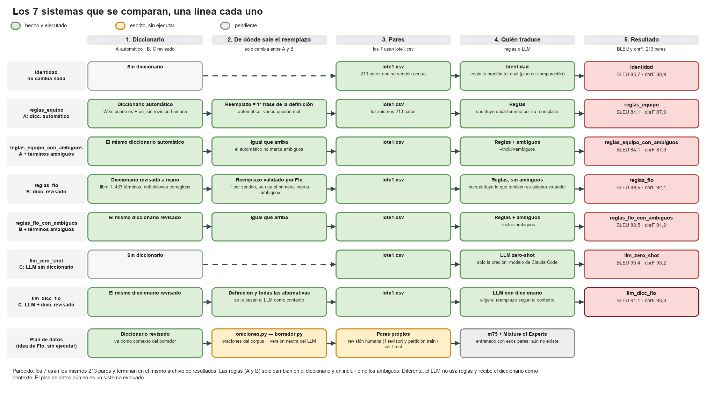
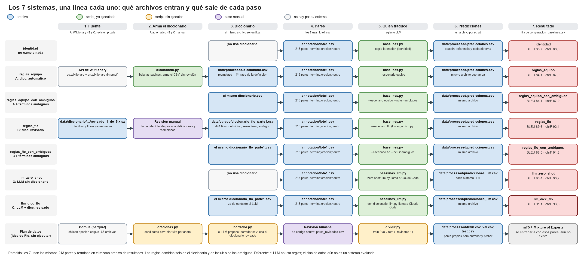

# idea_flo: sistema C, el plan de datos original de Flo

Código aparte del que usa el equipo. Es el **sistema C** del proyecto: le entrega al LLM la oración y el diccionario revisado, y además arma sus propios pares.
Visión general de los tres sistemas: [`../README.md`](../README.md). El diccionario revisado que usa: [`../README_flo.md`](../README_flo.md).





## Estado

| Script | Qué hace | Estado |
|---|---|---|
| `llm.py` | Llama al LLM (backend `claude-code` o `anthropic`) | Ejecutado (a través de `baselines_llm.py`) |
| `baselines_llm.py` | Baselines LLM zero-shot y LLM con diccionario | **Ejecutado** sobre `lote1.csv`; resultados en `../resultados/comparacion_baselines.csv` |
| `oraciones.py` | Busca oraciones del corpus con términos del diccionario | Escrito, **sin ejecutar** |
| `borrador.py` | El LLM propone la versión neutra de cada oración | Escrito, **sin ejecutar** |
| `dividir.py` | Separa los pares revisados en train / val / test | Escrito, **sin ejecutar** |

**Pendiente de revisar:** como `oraciones.py` y `borrador.py` aún no se ejecutan, **no hay ningún par propio y por lo tanto nadie ha revisado todavía un borrador**. La revisión humana (un revisor por ahora) es el paso que falta para tener pares de entrenamiento y prueba.

Todos importan `src/chilenismos/dicc.py` para leer el diccionario (`--escenario equipo|flo`).
**No se usó clave de API de Anthropic.** Todas las corridas usaron el backend `claude-code` (el que viene por defecto): llama al CLI de Claude Code con la sesión de Flo ya iniciada, sin clave y gastando el uso del plan, no un cobro por token.
`llm.py` también trae un backend `anthropic` (con `ANTHROPIC_API_KEY` en el entorno y cobro por uso), pero **nunca se ejecutó ni se probó**; se dejó solo por si el equipo prefiere una clave compartida. Por eso el paquete `anthropic` de `requirements.txt` es opcional.

## Resultados

BLEU y chrF sobre los 213 pares de `annotation/lote1.csv` (`../resultados/comparacion_baselines.csv`), con las reglas del sistema B como punto de comparación:

| Sistema | BLEU | chrF |
|---|---|---|
| Identidad (no cambia nada) | 85,7 | 88,9 |
| B. Reglas con el diccionario revisado | 89,6 | 92,1 |
| **C.** LLM zero-shot | 90,4 | 93,2 |
| **C.** LLM con el diccionario revisado como contexto | **91,1** | **93,8** |

- El LLM con el diccionario mejora 0,7 BLEU y 0,6 chrF sobre el LLM solo. Es una diferencia pequeña, sobre una muestra chica.
- El modelo es el de Claude Code (backend `claude-code`), traducido en lotes de 10 oraciones.
- **Cuidado al interpretarlo:** `lote1.csv` se armó con términos del diccionario del equipo y las referencias cambian poco del original. Si además las redactó un LLM, los sistemas con LLM salen favorecidos. Hay que repetirlo con un conjunto de prueba independiente.

## Plan
1. Diccionario → `diccionario.py` (equipo) y `data/curado/` (Flo).
2. **Oraciones del corpus con esos términos** → `oraciones.py`.
3. **Borrador del par chileno → neutro con un LLM, usando el diccionario como contexto**, y revisión humana → `borrador.py`.
4. **Conjunto de prueba y split** → `dividir.py`.
5. **Baselines con LLM** (zero-shot y con diccionario) → `baselines_llm.py`.

## Uso
```
# 2. candidatas (sin tuits por defecto: hay que consultar al profesor antes de publicar texto de tuits)
python idea_flo/oraciones.py --corpus RUTA/AL/CORPUS/data --escenario flo
#    -> data/interim/candidatas.csv (termino;oracion;fuente); data/interim no se sube a git

# 3. borrador
python idea_flo/borrador.py --seco --limite 5      # solo muestra el prompt, no llama al LLM
python idea_flo/borrador.py                        # -> annotation/borrador.csv
#    Quien revisa corrige `neutro` y anota su nombre en `revisor1` (y `revisor2`, si hay segunda revisión)

# 4. split
python idea_flo/dividir.py --pares annotation/pares_revisados.csv --revisores 1
#    --revisores 2 exige revisor1 y revisor2 en el test (doble revisión)

# 5. baselines con LLM
python idea_flo/baselines_llm.py --seco
python idea_flo/baselines_llm.py --escenario flo --resumen resultados/comparacion_baselines.csv
```

## Decisión por ahora: un solo revisor
Con un revisor no se puede medir el acuerdo entre personas ni se corrige el sesgo de esa persona. Es una limitación que hay que declarar en el informe.
Opción intermedia: una segunda persona revisa solo una muestra del test (por ejemplo 100 pares) y se reporta el acuerdo sobre esa muestra.

## Qué falta del plan original
Ejecutar y revisar los pares (arriba), baseline de Google Translate, fine-tune de mT5 y su variante con Mixture of Experts (hoy `baselines.py` solo corre mT5 sin entrenar), BERTScore y evaluación humana.
